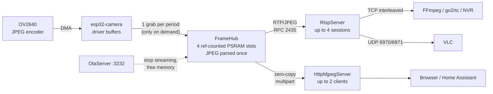

<div align="center">

# ESP32xCAM-RTSP

**Standards-compliant, multi-client RTSP & MJPEG streaming firmware for ESP32 camera boards**

[](https://github.com/iyotee/ESP32xCAM-RTSP/actions/workflows/ci.yml)
[](LICENSE)
[](https://platformio.org/)
[](https://github.com/espressif/arduino-esp32)
[](https://www.rfc-editor.org/rfc/rfc2326)
[](https://www.rfc-editor.org/rfc/rfc2435)
[](https://ffmpeg.org/)

One camera, many viewers: a single capture pipeline shared by every RTSP and HTTP client,<br>
with RFC-exact RTP/JPEG packetization that FFmpeg decodes without a single warning.

[Quick start](#-quick-start) •
[Features](#-features) •
[Clients & integrations](#-clients--integrations) •
[Architecture](#-architecture) •
[Configuration](#%EF%B8%8F-configuration) •
[Troubleshooting](#-troubleshooting)

</div>

---

## Table of contents

- [Why ESP32xCAM-RTSP](#-why-esp32xcam-rtsp)
- [Features](#-features)
- [Supported hardware](#-supported-hardware)
- [Quick start](#-quick-start)
- [Endpoints](#-endpoints)
- [Clients & integrations](#-clients--integrations)
- [Configuration](#%EF%B8%8F-configuration)
- [OTA firmware updates](#-ota-firmware-updates)
- [Architecture](#-architecture)
- [Protocol compliance](#-protocol-compliance)
- [Performance](#-performance)
- [Testing & validation](#-testing--validation)
- [Troubleshooting](#-troubleshooting)
- [Security considerations](#-security-considerations)
- [Migrating from ESP32CAM-RTSP-Multi](#-migrating-from-esp32cam-rtsp-multi)
- [Roadmap](#-roadmap)
- [Contributing](#-contributing)
- [License](#-license)

---

## 💡 Why ESP32xCAM-RTSP

ESP32xCAM-RTSP is a ground-up rewrite of
[ESP32CAM-RTSP-Multi](https://github.com/iyotee/ESP32CAM-RTSP-Multi). The previous
firmware worked "well enough" in a browser, but serious RTSP consumers (FFmpeg,
media servers, NVRs) flooded their logs with:

```text
[mjpeg @ 000002311e172100] overread 8
[mjpeg @ 000002311e172100] overread 8
[mjpeg @ 000002311e172100] overread 8
```

**Root cause:** the old firmware placed the *entire JPEG file* (SOI, APP0, DQT, DHT,
SOF, SOS…) in the RTP payload. [RFC 2435](https://www.rfc-editor.org/rfc/rfc2435)
receivers rebuild those headers themselves and expect **only the entropy-coded scan
data**. FFmpeg therefore decoded "its own headers + a second complete JPEG" and
reported `overread 8` on every single frame.

ESP32xCAM-RTSP parses and validates every frame and transmits exactly what the RFC
specifies. Compared on the same board:

| | ESP32CAM-RTSP-Multi | **ESP32xCAM-RTSP** |
|---|---|---|
| FFmpeg warnings | `overread 8` on every frame | **none** |
| RTP payload | full JPEG file (non-compliant) | **scan data only (RFC 2435)** |
| Quantization tables | implied by a fixed Q factor | **sent in-band (Q = 255), exact** |
| Captures with N clients | N captures (fps ÷ N) | **1 shared capture** |
| HTTP viewer impact on RTSP | blocks every RTSP client | **none (non-blocking)** |
| Partial TCP write | headers re-sent → corrupt stream | **resumed byte-exact** |
| Slow / frozen client | slows everyone down | **skips frames, then disconnected** |
| Incoming RTCP over TCP | parsed as RTSP text | **correctly framed and discarded** |
| SDP | invented attributes, hard-coded values | **minimal and exact** |
| OTA | open to the whole LAN | **HTTP Basic auth + rollback guard** |
| Automated tests | none | **19 host unit tests, FFmpeg loopback, live check, CI** |

---

## ✨ Features

### Streaming
- **RTSP 1.0 server** (RFC 2326): `OPTIONS`, `DESCRIBE`, `SETUP`, `PLAY`, `PAUSE`,
  `TEARDOWN`, `GET_PARAMETER` (keep-alive).
- **RTP/JPEG payload** (RFC 2435) with in-band quantization tables, automatic type
  (4:2:2 → 0, 4:2:0 → 1), restart-marker header when DRI is present, marker bit on
  the last packet of each frame.
- **Two transports**, chosen by the client: RTP over TCP (interleaved,
  RFC 2326 §10.12) and RTP over UDP unicast.
- **RTCP Sender Reports + SDES CNAME** (RFC 3550) every 5 s.
- **Real capture timestamps**: the 90 kHz RTP clock is derived from the sensor VSYNC
  time, not from the send time. Random SSRC, sequence number and timestamp origin.
- **HTTP MJPEG** (`multipart/x-mixed-replace`) for browsers and simple integrations,
  plus a **single-frame snapshot** endpoint.

### Multi-client by design
- **One capture, N consumers**: the `FrameHub` grabs at most one frame per period,
  only while someone is watching, and shares it with every client through
  reference-counted PSRAM slots.
- **Zero-copy fan-out**: HTTP clients stream JPEG bytes straight from the shared slot.
- **Latest-frame semantics**: a slow client always receives the newest frame and
  skips the ones it could not send, so latency never accumulates.
- **Stall protection**: a client that accepts no data for 1.5 s is disconnected; it
  can never slow down the others.
- Up to **4 RTSP sessions + 2 HTTP viewers** at the same time.

### Robustness
- **Single cooperative event loop, no blocking socket call**: no mutexes, no
  per-client tasks, no priority inversion.
- **Strict JPEG validation** before transmission: truncated frames, progressive JPEGs,
  non-standard Huffman tables, unsupported sampling or dimensions are rejected with an
  explicit log line instead of producing corrupt video.
- **Bounded, incremental RTSP parser**: fragmented or pipelined requests, interleaved
  `$` frames from the client, oversized requests (`413`) and garbage (`400`) are all
  handled safely.
- **Event-driven WiFi** with automatic reconnection, plus a watchdog that restarts the
  association if the link stays down for 30 s.
- **Camera auto-recovery**: initialization is retried every 5 s on failure.

### Operations
- **Authenticated OTA** over HTTP (port 3232), usable from `curl` or a browser.
- **Rollback guard**: a newly flashed image is confirmed only once WiFi and camera
  are up (effective when the bootloader supports rollback).
- **Periodic health log**: fps, frame size, sessions, rejected frames, free heap and
  PSRAM, RSSI.
- **Status page** on `http://<ip>/` with a live preview.
- **Continuous integration**: GitHub Actions builds the firmware, checks the OTA slot
  size and runs the unit tests on every push.

---

## 🔌 Supported hardware

| Board | Sensor | Status |
|---|---|---|
| **AI-Thinker ESP32-CAM** | OV2640 | ✅ Supported, validated on hardware |
| ESP32-S3 camera boards (Freenove, XIAO ESP32S3 Sense, ESP32-S3-EYE…) | OV2640 / OV3660 / OV5640 | 🗓️ Planned — see [Roadmap](#-roadmap) |
| ESP32-C3 / ESP32-C6 | — | ❌ No camera interface |

**Requirements**

- An ESP32 with **PSRAM** (the AI-Thinker module has 4 MB). Frame buffers live in
  PSRAM; the camera is not started without it.
- **4 MB flash** with the OTA layout of [`partitions_ota.csv`](partitions_ota.csv)
  (two 1.25 MB application slots).
- A **stable 5 V / ≥ 1 A power supply**. Most "random reboot" or "camera init failed"
  reports on ESP32-CAM boards are power problems.
- A **2.4 GHz** WiFi network (the ESP32 has no 5 GHz radio).
- For the very first flash: a USB-to-serial adapter (FTDI, CH340, CP2102) or an
  ESP32-CAM-MB programmer board.

---

## 🚀 Quick start

### 1. Prerequisites

- [PlatformIO](https://platformio.org/) — either the VS Code extension or PlatformIO
  Core (`pip install platformio`).
- Git.

### 2. Clone and configure

```bash
git clone https://github.com/iyotee/ESP32xCAM-RTSP.git
cd ESP32xCAM-RTSP
cp include/secrets.h.example include/secrets.h
```

Edit `include/secrets.h` (it is ignored by git):

```cpp
#define WIFI_SSID     "your-ssid"
#define WIFI_PASSWORD "your-wifi-password"

#define OTA_USERNAME  "admin"
#define OTA_PASSWORD  "a-long-random-password"
```

### 3. Build and flash over USB (first time)

Wire the adapter (5 V, GND, U0R ← TX, U0T → RX), connect **GPIO0 to GND**, reset the
board, then:

```bash
pio run -e esp32cam -t upload
pio device monitor
```

Remove the GPIO0 jumper and press reset. The serial log shows the address:

```text
[I] ESP32xCAM-RTSP/2.0 starting, reset reason 1
[I] WiFi connected, IP 192.168.1.173, RSSI -58 dBm
[I] camera ready: PID 0x26, framesize 11, quality 20
[I] ready: rtsp://192.168.1.173:8554/stream=0  http://192.168.1.173/mjpeg
```

### 4. Watch the stream

```bash
ffplay -rtsp_transport tcp rtsp://192.168.1.173:8554/stream=0
```

or open `http://192.168.1.173/` in a browser.

All later updates can be done [over the air](#-ota-firmware-updates).

---

## 🌐 Endpoints

| Service | URL / port | Notes |
|---|---|---|
| RTSP stream | `rtsp://<ip>:8554/stream=0` | TCP interleaved or UDP; track control `track1` |
| RTP / RTCP (UDP mode) | server ports `6970` / `6971` | shared by all UDP sessions |
| HTTP MJPEG | `http://<ip>/mjpeg` | `multipart/x-mixed-replace`, CORS enabled |
| Snapshot | `http://<ip>/jpg` | one JPEG, `Content-Length` set |
| Status page | `http://<ip>/` | live preview, session count |
| OTA upload page | `http://<ip>:3232/` | HTTP Basic auth |
| OTA upload endpoint | `POST http://<ip>:3232/upload` | multipart field `firmware` |

The device also registers the DHCP hostname **`esp32xcam`**.

---


## 📺 Clients & integrations

Any RTSP client that implements RFC 2435 (that is, virtually all of them) can consume
the stream. TCP transport is recommended on WiFi: it is immune to packet loss and
traverses NAT/firewalls.

<details open>
<summary><b>FFmpeg / ffplay / ffprobe</b></summary>

```bash
# Live preview
ffplay -rtsp_transport tcp -fflags nobuffer -flags low_delay rtsp://<ip>:8554/stream=0

# Inspect the stream
ffprobe -rtsp_transport tcp rtsp://<ip>:8554/stream=0
#   Stream #0:0: Video: mjpeg (Baseline), yuvj422p(pc, bt470bg/unknown/unknown), 800x600 [SAR 1:1 DAR 4:3], 10 fps, 25 tbr, 90k tbn

# Record without re-encoding (MJPEG in Matroska)
ffmpeg -rtsp_transport tcp -i rtsp://<ip>:8554/stream=0 -c copy camera.mkv

# Transcode to H.264 HLS (e.g. for a web backend)
ffmpeg -rtsp_transport tcp -i rtsp://<ip>:8554/stream=0 \
       -c:v libx264 -preset veryfast -tune zerolatency -pix_fmt yuv420p -g 20 \
       -f hls -hls_time 2 -hls_list_size 6 -hls_flags delete_segments stream.m3u8
```
</details>

<details>
<summary><b>VLC</b></summary>

*Media → Open Network Stream* → `rtsp://<ip>:8554/stream=0`.
To force TCP: *Tools → Preferences → Input / Codecs → Live555 stream transport → RTP over RTSP (TCP)*,
or from the command line:

```bash
vlc --rtsp-tcp rtsp://<ip>:8554/stream=0
```
</details>

<details>
<summary><b>go2rtc</b></summary>

```yaml
streams:
  esp32xcam:
    - rtsp://<ip>:8554/stream=0#timeout=15
    # Optional H.264 version for WebRTC / browsers:
    - ffmpeg:esp32xcam#video=h264
```
</details>

<details>
<summary><b>Frigate</b></summary>

```yaml
go2rtc:
  streams:
    esp32xcam:
      - rtsp://<ip>:8554/stream=0
      - "ffmpeg:esp32xcam#video=h264"

cameras:
  esp32xcam:
    ffmpeg:
      inputs:
        - path: rtsp://127.0.0.1:8554/esp32xcam
          input_args: preset-rtsp-restream
          roles: [detect, record]
    detect:
      width: 800
      height: 600
      fps: 5
```
</details>

<details>
<summary><b>Home Assistant</b></summary>

*Settings → Devices & services → Add integration → Generic Camera*:

| Field | Value |
|---|---|
| Still image URL | `http://<ip>/jpg` |
| Stream source URL | `rtsp://<ip>:8554/stream=0` |
| RTSP transport protocol | TCP |

Or with the MJPEG integration in `configuration.yaml`:

```yaml
camera:
  - platform: mjpeg
    name: ESP32xCAM
    mjpeg_url: http://<ip>/mjpeg
    still_image_url: http://<ip>/jpg
```
</details>

<details>
<summary><b>MediaMTX (re-streaming to many viewers)</b></summary>

The ESP32 serves at most 4 RTSP sessions. To serve more viewers, put a media server in
front of it and let it pull a single session:

```yaml
paths:
  esp32xcam:
    source: rtsp://<ip>:8554/stream=0
    rtspTransport: tcp
    sourceOnDemand: yes
```
</details>

<details>
<summary><b>Browser, Node-RED, OpenCV, others</b></summary>

- **Browser**: `/mjpeg">`, or open `http://<ip>/`.
- **Node-RED**: `http request` node on `/jpg` for snapshots, or any RTSP/MJPEG node.
- **OpenCV (Python)**:

  ```python
  import cv2
  cap = cv2.VideoCapture("rtsp://<ip>:8554/stream=0", cv2.CAP_FFMPEG)
  ok, frame = cap.read()
  ```

- **Blue Iris, Shinobi, ZoneMinder, Agent DVR, Scrypted, Homebridge (camera-ffmpeg),
  Domoticz, Jeedom, openHAB**: add a generic RTSP camera with the URL above, or an
  MJPEG camera on `/mjpeg`.
</details>

---


## ⚙️ Configuration

All settings are compile-time constants, split in two files:

| File | Content | In git |
|---|---|---|
| [`include/secrets.h`](include/secrets.h.example) | WiFi and OTA credentials, optional BSSID lock | ❌ ignored |
| [`include/config.h`](include/config.h) | camera, streaming, network and robustness settings | ✅ |
| [`include/board_pins.h`](include/board_pins.h) | camera pin map (AI-Thinker) | ✅ |

### `include/secrets.h`

| Macro | Required | Description |
|---|---|---|
| `WIFI_SSID` / `WIFI_PASSWORD` | ✅ | 2.4 GHz network credentials |
| `OTA_USERNAME` / `OTA_PASSWORD` | ✅ | credentials for the OTA page and endpoint |
| `WIFI_CHANNEL` + `WIFI_BSSID` | optional | lock onto one access point in a mesh / multi-AP network, e.g. `#define WIFI_BSSID {0x00,0x11,0x22,0x33,0x44,0x55}` |

The build fails with an explicit message if `secrets.h` is missing.

### `include/config.h`

| Constant | Default | Description |
|---|---|---|
| `kHostname` | `"esp32xcam"` | DHCP hostname |
| `kServerName` | `"ESP32xCAM-RTSP/2.0"` | RTSP `Server:` header and status page title |
| `kFrameSize` | `FRAMESIZE_SVGA` | resolution (800×600); see the table below |
| `kJpegQuality` | `20` | sensor JPEG quality, 0–63, **lower = better and larger** |
| `kXclkHz` | `20000000` | sensor clock |
| `kFrameBufferCount` | `2` | driver frame buffers in PSRAM |
| `kTargetFps` | `10` | capture and stream rate |
| `kRtspPort` | `8554` | RTSP listening port |
| `kRtspPath` | `"stream=0"` | stream path (`rtsp://<ip>:8554/stream=0`) |
| `kMaxRtspSessions` | `4` | simultaneous RTSP sessions; extra clients get `503` |
| `kRtspSessionTimeoutS` | `60` | session timeout advertised to clients |
| `kRtpServerPort` | `6970` | UDP RTP port (RTCP = +1) |
| `kRtpMaxPayload` | `1400` | RTP payload size, fits a 1500-byte MTU |
| `kHttpPort` | `80` | HTTP port |
| `kMaxHttpClients` | `2` | simultaneous HTTP connections |
| `kOtaPort` | `3232` | OTA port |
| `kSendStallTimeoutMs` | `1500` | a client that accepts no data for this long is dropped |
| `kClientIdleTimeoutMs` | `120000` | idle timeout for clients without keep-alive / RTCP |

### Choosing resolution and quality

RFC 2435 carries width and height divided by 8 in one byte each, so frames must be at
most **2040 × 2040** pixels with dimensions multiple of 8. Every OV2640 mode up to UXGA
qualifies:

| `kFrameSize` | Resolution | When to use it |
|---|---|---|
| `FRAMESIZE_QVGA` | 320×240 | many clients, weak WiFi signal |
| `FRAMESIZE_VGA` | 640×480 | motion detection, good balance |
| `FRAMESIZE_SVGA` | 800×600 | **default** |
| `FRAMESIZE_XGA` | 1024×768 | fewer clients or lower fps |
| `FRAMESIZE_HD` | 1280×720 | 16:9, fewer clients or lower fps |
| `FRAMESIZE_UXGA` | 1600×1200 | single client; the sensor delivers fewer fps |

Bandwidth ≈ *frame size × fps × number of clients*. Measured on an AI-Thinker board
at SVGA and 10 fps (frame size depends heavily on the scene):

| `kJpegQuality` | Average frame | Per client | 2 RTSP + 1 UDP + 1 HTTP clients |
|---|---|---|---|
| 12 | ~42 KB | ~3.4 Mbit/s | WiFi saturated: 6–7 fps per client |
| **20** (default) | **~18 KB** | **~1.4 Mbit/s** | **10 fps for every client** |

### Sensor tuning

Picture settings (exposure, gain, white balance, mirror, flip…) are applied in
`applySensorSettings()` in [`src/Camera.cpp`](src/Camera.cpp). To flip the image of
an upside-down camera, set `s->set_vflip(s, 1)` and `s->set_hmirror(s, 1)`.

### Log level

`platformio.ini` builds with `CORE_DEBUG_LEVEL=3` (info). Use `4` for debug logs
(every RTSP request is printed) or `1` for errors only.

---

## 🔄 OTA firmware updates

After the first USB flash, updates go over WiFi. The upload is authenticated with the
credentials of `secrets.h`.

**From the command line** (recommended):

```bash
pio run -e esp32cam
curl -u admin:<OTA_PASSWORD> \
     -F "firmware=@.pio/build/esp32cam/firmware.bin" \
     http://<ip>:3232/upload
# → Update successful, rebooting
```

**From a browser**: open `http://<ip>:3232/`, log in, choose `firmware.bin`, upload.

What happens during an update:

1. Credentials are checked before a single byte is written to flash (`401` otherwise).
2. Streaming stops: RTSP and HTTP clients are closed, the camera is shut down and the
   frame memory is released, so the upload has the whole CPU and RAM.
3. The image is written to the inactive OTA slot and verified.
4. The board reboots — into the new image on success, back into the current one on
   failure.
5. **Rollback guard**: the new image is marked valid only once WiFi is connected and
   the camera is running. If WiFi cannot be joined within 30 s at boot, the image
   requests a rollback. This protects you from a remote "brick" when the bootloader
   supports rollback (`CONFIG_BOOTLOADER_APP_ROLLBACK_ENABLE`).

> [!IMPORTANT]
> OTA cannot change the partition table. Keep `partitions_ota.csv` identical to the
> one on the device and keep `firmware.bin` below **1,310,720 bytes** (the CI checks
> this). The current build is about 1.1 MB.

---


## 🏗️ Architecture

### Overview



Everything runs in **one cooperative loop** on the Arduino task (core 1). Each
iteration:

1. checks WiFi health and serves the OTA server;
2. lets the `FrameHub` capture a frame if one is due **and** at least one client wants
   frames;
3. lets every RTSP session read requests, packetize and send what its socket accepts;
4. does the same for HTTP clients;
5. yields for 1 ms (idle task, watchdog, lwIP).

No streaming socket call ever blocks. Back-pressure is handled per client by a
fixed-size `Outbox` that resumes partial writes exactly where they stopped.

### Source tree

```text
ESP32xCAM-RTSP/
├── include/
│   ├── config.h              all tunables (constexpr, namespace cfg)
│   ├── secrets.h.example     template for WiFi / OTA credentials
│   └── board_pins.h          camera pin map
├── lib/                      platform-independent, unit-tested
│   ├── rtpjpeg/
│   │   ├── JpegScan          JPEG parser, RFC 2435 validation, scan extraction
│   │   ├── HuffmanStd.h      ITU-T T.81 Annex K tables (validation reference)
│   │   ├── RtpJpegPacketizer RTP + JPEG headers, fragmentation, marker bit
│   │   └── Rtcp              RTCP Sender Report + SDES CNAME
│   └── rtsp/
│       └── RtspParser        incremental bounded parser, Transport header, URI matching
├── src/                      firmware (Arduino-ESP32)
│   ├── main.cpp              boot sequence, event loop, health log
│   ├── Camera                sensor init/deinit, RAII frame-buffer guard
│   ├── FrameHub              capture scheduling, PSRAM slots, reference counting
│   ├── RtspServer            listener, session pool, shared UDP sockets
│   ├── RtspSession           RTSP state machine, RTP over TCP/UDP, RTCP
│   ├── HttpMjpegServer       non-blocking HTTP/1.1, multipart stream, snapshot
│   ├── OtaServer             authenticated upload, rollback guard
│   ├── WifiLink              station mode, events, reconnection watchdog
│   └── net/
│       ├── Socket            RAII non-blocking lwIP sockets
│       └── Outbox.h          ordered transmit queue, zero-copy tail, stall detection
├── test/                     Unity tests run on the host (pio test -e native)
├── tools/                    FFmpeg-based validation scripts
├── .github/workflows/ci.yml  build + size check + unit tests
├── partitions_ota.csv        4 MB layout with two OTA slots
└── platformio.ini            esp32cam + native environments
```

### Design decisions

| Decision | Rationale |
|---|---|
| **One shared capture** (`FrameHub`) | The sensor produces one stream; capturing per client divides the frame rate. |
| **Copy the JPEG out of the driver buffer** | The driver buffer goes back immediately, so the sensor never starves, and slow clients can hold a slot as long as they need. Copying ~18 KB costs far less than a stalled DMA pipeline. |
| **Reference-counted slots, latest-frame policy** | A slow client keeps its frame alive without blocking capture; when done it jumps to the newest frame instead of building up latency. |
| **Parse every JPEG once, at capture** | Validation and scan extraction are shared by all RTSP sessions. A frame that RFC 2435 cannot carry is still served over HTTP. |
| **Quantization tables in-band (Q = 255)** | The receiver uses the exact tables of each frame instead of deriving them from a quality factor; any sensor quality setting works. |
| **Keep EOI at the end of the scan** | RFC 2435 receivers tolerate trailing bytes; with it, FFmpeg never prints `EOI missing, emulating`. |
| **Single event loop, non-blocking sockets** | Deterministic, no locks, no per-client stacks, no priority inversion between clients. |
| **Fixed-size buffers, no `String` in the hot path** | No heap fragmentation over weeks of uptime. |
| **One UDP socket pair for all sessions** | lwIP is built with 16 sockets; per-session UDP sockets would cap the client count. |
| **Platform-independent `lib/`** | Protocol code is compiled and tested on a PC with `-Werror`, including exhaustive truncation tests. |

### Memory footprint

| Item | Location | Size |
|---|---|---|
| Firmware image | flash (1.25 MB OTA slot) | ~1.1 MB |
| Static RAM (`.data` + `.bss`) | internal DRAM | ~95 KB of 320 KB |
| Driver frame buffers (×2) | PSRAM | allocated by the camera driver |
| FrameHub slots (×4) | PSRAM | grown on demand in 16 KB steps |
| Per RTSP session | internal DRAM (static) | ~11 KB (1 KB rx, 8 KB tx, 1.4 KB UDP packet) |
| Per HTTP client | internal DRAM (static) | ~1.5 KB |

---


## 📐 Protocol compliance

### RTSP (RFC 2326)

| Method | Behaviour |
|---|---|
| `OPTIONS` | lists supported methods in `Public:` |
| `DESCRIBE` | returns the SDP, with `Content-Base: rtsp://<ip>:8554/stream=0/` |
| `SETUP` | accepts `RTP/AVP/TCP;interleaved=a-b` or `RTP/AVP[/UDP];client_port=a-b`; replies with `ssrc=` and `Session: <id>;timeout=60` |
| `PLAY` | starts from the newest frame; replies with `Range` and `RTP-Info` (`seq`, `rtptime`) |
| `PAUSE` | stops sending, keeps the session |
| `TEARDOWN` | replies, then closes once the reply has been sent |
| `GET_PARAMETER` | keep-alive |
| anything else | `501 Not Implemented` |

Error responses: `400` malformed request, `404` unknown URI, `413` request larger than
the 1 KB receive buffer, `454` unknown session, `455` method not valid in the current
state, `461` unsupported transport (multicast, missing client ports), `503` all
sessions in use.

### SDP (RFC 4566)

Minimal and exact — nothing a player cannot use:

```text
v=0
o=- 1234567890 1 IN IP4 192.168.1.173
s=ESP32-CAM
c=IN IP4 0.0.0.0
t=0 0
a=control:*
a=range:npt=0-
m=video 0 RTP/AVP 26
a=rtpmap:26 JPEG/90000
a=framerate:10
a=control:track1
```

### RTP/JPEG (RFC 2435, RFC 3550, RFC 3551)

- Static payload type **26**, 90 kHz clock, random SSRC, sequence and timestamp origin.
- Payload = **entropy-coded scan only** (after SOS, up to and including EOI),
  fragmented into ≤ 1,400-byte packets with a 24-bit fragment offset.
- **Type** from the sampling factors: luma 2×1 → type 0 (4:2:2, OV2640 default),
  luma 2×2 → type 1 (4:2:0); +64 and a Restart Marker header when the frame has a DRI.
- **Q = 255**: Quantization Table header (2 × 64 bytes, 8-bit) in the first packet of
  every frame.
- Marker bit on the last packet of each frame; all packets of a frame share the
  capture timestamp.
- **Frames that RFC 2435 cannot describe are rejected, never sent corrupt**:
  progressive or lossless JPEG, 12-bit precision, non-YCbCr images, sampling other than
  4:2:2 / 4:2:0, chroma planes with different tables, non-standard Huffman tables
  (receivers always use ITU-T T.81 Annex K), dimensions not multiple of 8 or above
  2040, truncated frames.

### RTCP (RFC 3550)

Sender Report + SDES CNAME (`esp32xcam@<ip>`) every 5 s on the RTCP channel
(interleaved channel *b* in TCP mode; UDP 6971 → client RTCP port in UDP mode).
Receiver Reports from clients are accepted as keep-alives.

---

## 📊 Performance

Measured on an AI-Thinker ESP32-CAM (OV2640, SVGA, quality 20, 10 fps target, RSSI
around −60 dBm), with FFmpeg 8.0.1 clients on the LAN:

| Scenario | Result |
|---|---|
| 1 RTSP client, TCP, 20 s | 200 frames, **10.0 fps**, 0 FFmpeg warnings |
| 1 RTSP client, UDP, 30 s | 300 frames, **10.0 fps**, 0 FFmpeg warnings |
| 2 RTSP/TCP + 1 RTSP/UDP + 1 HTTP MJPEG, 60 s | **10.0 / 9.9 / 9.9 / 10.0 fps**, no decoding error (3 UDP packets lost out of ~6,000 — WiFi congestion) |
| Healthy client next to a frozen client (TCP window full) | healthy client keeps **10.0 fps**; frozen client disconnected after ~1.5 s |
| RTSP → H.264 HLS transcode with FFmpeg, 20 s | 10 segments, 0 warnings |
| Fragmented request (1 byte / 10 ms), garbage request, oversized request | `200`, `400`, connection closed — server unaffected |
| 6 simultaneous connections with 4 sessions available | extra connections answered `503` |

Limits:

- **Sessions**: lwIP is built with 16 sockets. ESP32xCAM-RTSP uses 3 listening
  sockets, 2 UDP sockets, up to 4 RTSP and 2 HTTP connections and 1 OTA connection.
  Use a [media server](#-clients--integrations) to serve more viewers.
- **WiFi throughput** is the real bottleneck: count ~1.4 Mbit/s per client at the
  defaults and leave headroom.

---

## 🧪 Testing & validation

The protocol libraries have **19 host unit tests** covering JPEG parsing, malformed
and truncated images, RTP/JPEG packetization, RTCP sender reports, and incremental
RTSP parsing. They run without an ESP32:

```bash
pio test -e native
```

The firmware build and OTA slot-size check run in [GitHub Actions](.github/workflows/ci.yml).
To build locally, first create `include/secrets.h` from the placeholder template:

```bash
cp include/secrets.h.example include/secrets.h
pio run -e esp32cam
```

Two FFmpeg checks are included in [`tools/`](tools/):

- **Offline packetization check** (no camera required; needs `g++` and FFmpeg):

  ```bash
  python tools/ffmpeg_loopback.py path/to/camera-image.jpg 30 1
  ```

  It packetizes the supplied JPEG and checks that FFmpeg decodes every frame
  identically to the source, without JPEG/RTP warnings.
- **Live camera check** (needs a flashed camera and FFmpeg):

  ```bash
  python tools/rtsp_check.py <ip> --seconds 60 --tcp 2 --udp 1 --http 1 --fps 10
  ```

  It reports frame rate and decoding warnings for concurrent RTSP and HTTP clients.

---

## 🩺 Troubleshooting

| Symptom | What to check |
|---|---|
| The build says `include/secrets.h is missing` | Copy `include/secrets.h.example` to `include/secrets.h` and set your WiFi and OTA credentials. |
| WiFi does not connect | Use a 2.4 GHz network and verify the SSID and password in `secrets.h`. Check the serial log for the connection status. |
| `camera init failed` or no video | Verify the AI-Thinker pin map, camera ribbon, PSRAM, and a stable 5 V power supply. Camera initialization is retried every 5 seconds; inspect the serial log for subsequent status. |
| RTSP works but a viewer shows no frames | Try TCP transport and `rtsp://<ip>:8554/stream=0`. The ESP32-CAM serves at most four RTSP sessions. |
| MJPEG or snapshots stop responding | The HTTP server allows two clients. Disconnect unused viewers, then retry `/mjpeg` or `/jpg`. |
| OTA authentication fails | Use the `OTA_USERNAME` and `OTA_PASSWORD` from the local `secrets.h`. The OTA page and upload endpoint are on port `3232`. |
| OTA upload fails or the board rolls back | Check the serial log and firmware size. The binary must fit the 1,310,720-byte OTA slot, and the partition table must match the one already flashed. |
| WiFi drops during operation | The firmware reconnects automatically and restarts association if the link remains down for 30 seconds. Check signal strength and power stability. |

For further diagnosis, use `pio device monitor` at **115200 baud** and consult the
periodic health log for frame rate, rejected frames, capture errors, free heap/PSRAM,
and WiFi RSSI.

---

## 🔐 Security considerations

- Keep `include/secrets.h` local. It is ignored by Git; commit only the
  [`include/secrets.h.example`](include/secrets.h.example) template with placeholders.
- WiFi and OTA credentials are compiled into the firmware image. Treat firmware
  binaries as sensitive and do not publish them if they contain your real credentials.
- OTA uses HTTP Basic authentication over plain HTTP, not TLS. Use a strong,
  unique OTA password and keep port `3232` on a trusted network; do not expose it
  directly to the Internet.
- Changing the credentials in the source requires rebuilding and flashing the
  firmware. If exposed, change the WiFi password on the access point and device,
  and replace the OTA password in the firmware.

---

## 🔄 Migrating from ESP32CAM-RTSP-Multi

ESP32xCAM-RTSP is a rewrite, not a drop-in firmware update. Back up any existing
settings, then follow the [quick start](#-quick-start) to install and configure this
project. The first installation should be flashed over USB; only use OTA after this
firmware is running and authenticated OTA is available.

The OTA partition layout must stay identical to
[`partitions_ota.csv`](partitions_ota.csv). Do not use OTA to change the partition
table or to install an image built for a different layout.

---

## 🗺️ Roadmap

- ESP32-S3 camera-board support (including boards with OV2640, OV3660, and OV5640
  sensors).
- Additional hardware validation beyond the AI-Thinker ESP32-CAM.

See [Supported hardware](#-supported-hardware) for current status.

---

## 🤝 Contributing

Contributions and bug reports are welcome. For changes to the protocol libraries,
run the native unit tests and the offline FFmpeg check. For firmware changes, also
build the `esp32cam` environment and, when hardware is available, run the live
camera check:

```bash
pio test -e native
pio run -e esp32cam
python tools/ffmpeg_loopback.py path/to/camera-image.jpg 30 1
```

Do not include local credentials, generated firmware, or other private test data in
a contribution.

---

## 📄 License

This project is distributed under the [MIT License](LICENSE).


